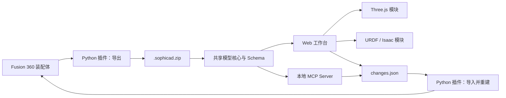

# Fusion–Three.js–URDF 双向桥接系统设计

**日期：** 2026-08-28

**状态：** 已经用户逐节确认，等待书面复核

**测试模型：** `/Users/wubo/Desktop/test1.f3d`（四连杆）

## 1. 目标

构建一套面向任意 Autodesk Fusion 装配体的双向工作流：Fusion 360 Python 插件导出参数、装配、Joint、BOM、物性、网格和机器人语义；本地优先的 Web 工作台使用 Three.js 查看和编辑模型，并生成 ROS/Isaac 可用的 URDF；Web 导出的更新包可以由 Fusion 插件显式导入，重新计算原始参数化模型。

四连杆只作为首个端到端验收样例。系统的首要应用是车辆底盘、悬架、转向机构和机器人关节。

## 2. 范围

### 2.1 首版包含

- 面向任意 Fusion 装配体的递归导出，而不是为四连杆硬编码。
- Fusion 用户参数表达式、求值、单位、依赖和注释的无损保存与写回。
- 组件定义、Occurrence 实例、层级、变换、可见性和 grounded 状态。
- Fusion Joint、As-Built Joint、运动类型、轴、原点、限位和闭环关系。
- 组件/实例 BOM、零件号、描述、材料、质量、重心和惯量。
- Three.js 装配查看、选择、测量、运动控制、参数编辑和状态提示。
- URDF 主树生成、机器人属性编辑、验证，以及闭环约束 sidecar。
- Web 生成更新包，Fusion 用户点击“导入并重建”。
- 本地 MCP Server 读取数据包、分析装配、生成参数修改和 URDF。
- 四连杆闭环实时求解；其他闭环完整保存、诊断并按支持矩阵处理。

### 2.2 首版不包含

- Web 在浏览器中复刻 Fusion 草图求解器、B-Rep 内核或特征时间线。
- 后台服务或云端 Fusion 自动重建。
- MCP 直接远程控制 Fusion UI。
- 无提示覆盖原始 `.f3d`、`.sophicad.zip` 或用户选择的输出文件。
- 对外部引用、派生组件或只读参数进行强制写回。
- 对任意三维多环机构承诺实时闭环动力学求解。

## 3. 核心原则

1. **Fusion 是唯一几何权威。** Web 负责参数修改意图、运动学、机器人语义和预览；精确几何由 Fusion 重建。
2. **离线、显式、可恢复。** 往返通过版本化数据包完成，用户在 Fusion 中明确点击导入。
3. **数据无损优先于格式伪装。** URDF 无法表达的闭环或复合约束保留在 `constraints.json`，不静默丢弃。
4. **组件与实例分离。** 几何按组件复用，位置、Joint 和 BOM 数量按 Occurrence 保存。
5. **SI 为交换标准。** 计算数据使用米、千克、弧度；Fusion 原始单位与表达式原样保留。
6. **所有降级可见。** 过期网格、不支持写回、虚拟 Joint、切断闭环和缺失物性必须在 UI、报告和 MCP 返回中明确标注。

## 4. 总体架构



代码单元：

- `fusion_addin/`：Fusion 360 Python 插件、Fusion API 适配器、导入/导出与诊断。
- `packages/schema/`：JSON Schema、版本迁移、示例和跨语言生成类型。
- `packages/core/`：TypeScript 数据模型、单位、图算法、参数补丁、URDF、验证与运动学。
- `web/`：React/TypeScript/Vite/Three.js 工作台。
- `mcp/`：复用核心包的本地 stdio MCP Server。
- `fixtures/`：四连杆数据包、更新包和预期 URDF。

Web 和 MCP 不直接解析 `.f3d`。插件只通过 Fusion 官方 API 读取已打开的设计；`.f3d` 归档内部格式不作为产品接口。

## 5. 数据包契约

### 5.1 文件结构

```text
manifest.json
model.json
changes.json
meshes/
  visual/<component-id>.glb
  collision/<component-id>.stl
robot/
  robot.urdf
  constraints.json
reports/
  validation.json
```

初始 Fusion 导出包可以不含 `changes.json`。Web 或 MCP 产生的更新包必须包含它。`robot/robot.urdf` 和报告是可再生成产物，`model.json` 与 `changes.json` 是往返权威数据。

### 5.2 `manifest.json`

至少包含：

- `schemaVersion`：语义版本，例如 `1.0.0`。
- `packageId`：本次导出的 UUID。
- `createdAt`、`producer`、`producerVersion`。
- `source.designGuid`：由插件首次写入根组件 attribute 的持久 GUID。
- `source.documentName`、`source.dataFileId`、`source.versionId`（不可用时为 `null`）。
- `source.fingerprint`：参数、组件、Occurrence 和 Joint 关键字段的规范化 SHA-256。
- `coordinateSystem`：源基准与 ROS 基准之间的 4×4 变换。
- 每个文件的路径、用途、字节数和 SHA-256。

为避免自引用哈希，`files` 清单覆盖除 `manifest.json` 自身之外的全部文件；任何未声明文件都必须被读取器拒绝。

### 5.3 `model.json`

顶层包含：

- `units`：`length: m`、`mass: kg`、`angle: rad`，以及 Fusion 文档显示单位。
- `parameters.user[]`：名称、单位、原始表达式、SI 求值、文本值、注释、favorite、依赖、可写状态。
- `parameters.model[]`：模型参数的只读索引，用于解释依赖和定位特征。
- `components[]`：组件 ID、名称、零件号、描述、材料、body、appearance、mesh 引用。
- `occurrences[]`：实例 ID、组件引用、父实例、完整路径、entity token、局部/世界变换、可见性、grounded、只读原因。
- `joints[]`：Joint ID、名称、父/子实例、Fusion 类型、原点、轴、自由度、当前位置、限位、抑制状态、闭环标记和写回能力。
- `physicalProperties[]`：质量、体积、重心、惯量张量、精度和来源。
- `bom[]`：组件/零件号聚合数量及全部实例路径。
- `robot`：root link、link 映射、Joint 覆盖、虚拟 link、执行器属性和闭环策略。

稳定定位使用持久设计 GUID、Fusion entity token、组件 ID 和完整 Occurrence 路径的组合。entity token 只用于 `findEntityByToken`，不通过字符串相等判断实体身份。

### 5.4 坐标和单位

- 交换坐标遵循 ROS 约定：X 前、Y 左、Z 上。
- Fusion 导出时用户可以选择根组件原点、Joint Origin 或构造坐标系作为机器人基准；未选择时使用根组件原点并产生警告。
- 所有矩阵为列主序或行主序中的一种；Schema 固定为长度 16 的行主序数组，代码不得混用。
- 角度使用弧度，Fusion 表达式字符串仍保留原始角度单位。
- 惯量统一为 kg·m²，并记录惯量参考坐标系和重心位姿。

### 5.5 `changes.json`

包含：

- `basePackageId`、`baseFingerprint`、`targetDesignGuid`。
- `parameterChanges[]`：参数名、旧表达式、新表达式、预期旧值。
- `jointChanges[]`：字段级修改及 `writebackMode`。
- `robotOverrides[]`：只作用于 Web/URDF/Isaac 的轴、类型、阻尼、摩擦和执行器属性。
- `bomOverrides[]`：只允许修改非几何业务字段，不篡改由装配计算的数量。
- `author`、`createdAt` 和可选说明。

导入器拒绝设计 GUID 不匹配、基础指纹不匹配且无法安全三方合并、Schema 主版本不支持或校验和错误的数据包。

## 6. Fusion 360 插件

### 6.1 UI 命令

插件安装在 Fusion“实用工具”面板，提供：

1. **导出 SophiCAD 数据包**
2. **导入并重建**
3. **装配诊断**

导出对话框包含输出路径、机器人基准、root link、网格精度、物性精度、隐藏组件选项和碰撞网格选项。

### 6.2 导出流程

1. 验证活动产品为 Fusion Design。
2. 获取或创建持久设计 GUID。
3. 递归遍历组件和 Occurrence；读取普通 Joint 与 As-Built Joint。
4. 读取用户参数和只读模型参数索引，提取表达式依赖。
5. 计算高精度物性并转换到选定基准。
6. 对唯一组件生成 GLB 视觉网格和 STL 碰撞网格。
7. 构建 BOM、装配图、闭环集合与 URDF 主树。
8. 验证数据、生成报告、计算文件哈希并原子写出新包。

网格按组件局部坐标导出；Occurrence 变换只存在于模型数据中。相同组件的多个实例不得重复导出网格。

### 6.3 导入和回滚

1. 验证压缩包路径、Schema、校验和、设计 GUID 和基础指纹。
2. 解析并展示逐字段变更预览。
3. 在内存中保存所有待修改 Fusion 字段的原值。
4. 用 Fusion UnitsManager 验证参数表达式；依赖图必须无新增循环。
5. 按依赖顺序应用用户参数表达式。
6. 仅对支持且没有重新选几何需求的同类型 Joint 限位执行 Fusion 写回。
7. 将机器人专用覆盖保存到 SophiCAD attribute，不改坏 Fusion Joint 几何。
8. 调用 `Design.computeAll()`，然后检查所有受影响时间线项的 health state。
9. 失败时恢复原值、再次 `computeAll()` 并输出失败报告；成功时输出前后差异报告。

参数写回是首版的精确闭环。Joint 类型或轴向若需要重新选择 Fusion Joint 几何，首版只作为机器人覆盖配置保存；UI 必须明确显示“未写回 Fusion Joint”。

### 6.4 诊断

诊断项包括：

- 无 root、多 root、悬空组件和未约束自由度。
- 重复或 URDF 非法名称。
- Joint 缺失实例、被抑制、推断类型或不支持映射。
- 闭环和被选为 URDF 切边的 Joint。
- 外部引用、派生组件和只读参数。
- 缺失材料、零/负质量、非正定惯量和空网格。
- 参数依赖循环、无效表达式和时间线错误。

诊断结果可定位到 Fusion 实体，并写入 `reports/validation.json`。

## 7. Web 工作台

### 7.1 技术与运行边界

- React、TypeScript、Vite、Three.js。
- 静态部署；使用浏览器 File API 读写本地数据包。
- 不上传模型，不需要登录或后端。
- 共享核心逻辑独立于 React，确保 Web 和 MCP 结果一致。

### 7.2 布局

- 顶部状态栏：模型、Fusion 源版本、未保存修改、网格过期、错误/警告计数、下载更新包。
- 左侧：装配树、可见性、ground/root 和闭环状态。
- 中央：Three.js 视口或 URDF 树视图。
- 右侧：参数、Joint、link、物性、BOM 和问题检查器。
- 底部：Joint 控制、运动播放、限位和闭环状态。

### 7.3 Three.js 模块

- 导入 GLB/STL，按 Occurrence 层级和变换实例化。
- 支持选择、高亮、隔离、透明、剖视、测量、相机预设和坐标轴。
- 参数表支持搜索、表达式编辑、单位显示、依赖查看和差异恢复。
- 修改可能影响几何或 Joint 原点的参数后，相关网格与运动学标记为 stale，直到 Fusion 重建并重新导出。
- 用户可为常见连杆、轮胎、轴和型材配置参数驱动代理，以便即时近似预览；代理结果不得覆盖权威网格。
- 固定、旋转和移动 Joint 直接支持；圆柱等复合自由度使用虚拟 Joint 表达。
- 首版提供平面单闭环旋转机构求解器，覆盖四连杆。其他复杂闭环保留、着色并诊断，但不声称实时精确闭合。

### 7.4 URDF / Isaac 模块

- 运动树与 Three.js 选择联动。
- 编辑 root link、link/joint 映射、轴、限位、阻尼、摩擦、effort、velocity 和执行器元数据。
- 查看并覆盖质量、重心和惯量；覆盖必须与 Fusion 原值同时展示。
- 验证单根树、唯一名称、父子引用、网格存在、质量和惯量。
- 生成标准 URDF，并支持 ROS `package://` 与相对路径两种 mesh URI 模式。
- 对球、圆柱、平面和 pin-slot 等类型按明确映射规则分解为虚拟 link/joint，或在用户选择时降级为 fixed；所有降级进入报告。
- URDF 主树之外的 Fusion 闭环保存在 `constraints.json`，包含被切 Joint 的原始类型、父子、位姿、轴、限位和来源 ID。

### 7.5 错误处理

- 包版本、哈希、Schema 或文件缺失错误阻止编辑并给出可操作信息。
- 可恢复数据问题以 warning 呈现，不静默丢弃。
- 更新包下载前必须通过结构校验；错误阻止下载，警告需要用户确认。
- 浏览器刷新前若有未下载修改，触发离开提示。

## 8. MCP Server

MCP Server 使用 Node.js/TypeScript，通过 stdio 运行，复用 `packages/core`。默认工具只读；所有写操作必须提供与输入不同的输出路径。

### 8.1 工具

- `inspect_assembly(packagePath)`：返回摘要、层级、物性、BOM、Joint 和问题。
- `list_parameters(packagePath, filter?)`：返回参数表达式、单位、依赖和写回能力。
- `propose_parameter_changes(packagePath, changes)`：校验意图并返回差异，不写文件。
- `create_update_package(packagePath, outputPath, changes)`：生成新的更新包。
- `analyze_kinematics(packagePath)`：返回自由度、根、闭环、URDF 切边和支持等级。
- `generate_urdf(packagePath, outputDirectory, options?)`：生成 URDF、mesh 和 sidecar。
- `validate_package(packagePath)`：执行完整 Schema、图、物性和资源检查。
- `compare_versions(leftPackagePath, rightPackagePath)`：比较参数、装配、BOM、质量、网格和机器人语义。

### 8.2 安全边界

- 不启动、点击或控制 Fusion。
- 不覆盖输入包。
- 不执行包内脚本或外部命令。
- 解压时拒绝绝对路径和 `..` 路径，限制文件数量、单文件大小和总解压大小。
- 工具返回结构化 `errors`、`warnings`、`changes` 和 `nextActions`。

## 9. URDF 与闭环策略

URDF 要求 link/joint 构成一棵树。系统根据用户选择的 root link 构建有向图，优先保留：

1. 用户锁定为主树的 Joint。
2. 刚性连接。
3. Fusion 中未抑制且有明确运动类型的 Joint。
4. 距 root 更近、能保持稳定 link 层级的 Joint。

形成环的边被标记为 loop closure 并移入 `constraints.json`。四连杆测试中，URDF 保留三条形成主树的运动 Joint，第四条闭环 Joint 作为 sidecar 约束。Three.js 使用完整图；URDF/ROS 使用主树；Isaac 导入后的闭环恢复由 sidecar 和后续适配器负责。

## 10. 测试策略

### 10.1 TypeScript 核心

- JSON Schema 正反例。
- SI/文档单位和惯量转换。
- 参数依赖排序、循环检测和差异补丁。
- 组件/Occurrence 实例化和 BOM 聚合。
- root 选择、闭环检测、确定性切边和虚拟 Joint。
- URDF 名称、树、惯量和 mesh 引用验证。
- 平面四连杆闭环求解。

### 10.2 Fusion Python

- 将 Fusion API 包装为薄 adapter，纯 Python 逻辑使用 fake adapter 单元测试。
- 导出模型、文件清单、指纹和 ZIP 安全性测试。
- 导入验证、表达式顺序、指纹拒绝、失败回滚和报告测试。
- 在 Fusion 内对 `test1.f3d` 执行人工/脚本化 smoke test。

### 10.3 Web 与 MCP

- Web 组件测试和核心状态测试。
- Playwright 覆盖导入、选择、编辑参数、URDF 检查和下载更新包。
- MCP 覆盖所有工具输入 Schema、只读边界、输出路径和结构化错误。
- 生产构建、TypeScript 类型检查、Python 语法检查和全量测试作为完成门槛。

## 11. 四连杆验收标准

使用 `/Users/wubo/Desktop/test1.f3d`：

1. 插件成功导出，并包含 `w1、w2、l1、l2、d、t1、t2` 的名称、单位、表达式和值。
2. Web 显示四连杆装配、各 Occurrence、Joint、参数、物性和 BOM。
3. Three.js 可驱动四连杆运动并维持平面闭环；到达限位时停止并提示。
4. 将 `l1` 从 `200 mm` 改为 `220 mm` 后，Web 标记相关网格 stale，并生成更新包。
5. Fusion 插件只允许更新包导入匹配设计，写入新表达式，执行全量计算且时间线健康。
6. 重新导出后，`l1`、网格、包围盒和受影响物性发生预期变化，组件实例与 BOM 数量保持一致。
7. URDF 是有效单根树；被切断的闭环 Joint 完整存在于 `constraints.json`。
8. MCP 能列出参数、识别闭环、验证包并生成等价的 `l1 = 220 mm` 更新包。

## 12. 完成定义

- Fusion 插件可以安装、显示三个命令，并完成四连杆导出/导入重建闭环。
- Web 可以本地启动和生产构建，完成 Two-module 工作流。
- MCP Server 可由兼容客户端通过 stdio 调用。
- Schema、示例、安装和使用文档齐全。
- 自动测试通过；Fusion 内 smoke test 有明确执行记录。
- 已知不支持项在 UI、报告和文档中一致显示，没有静默数据丢失。
