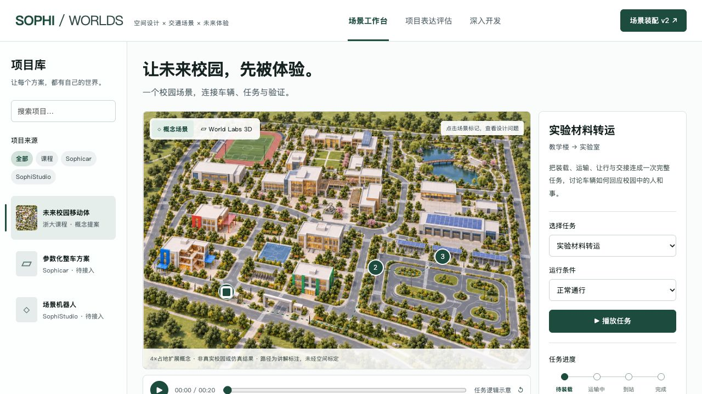
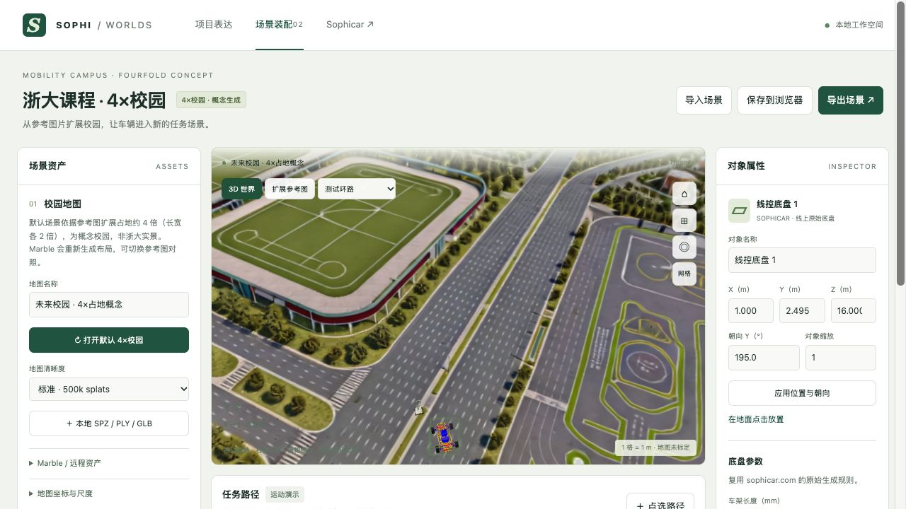

运行更新：默认精度已升为 192 万点，地面网格已用于道路路线与车辆运动。请参阅 [建筑清晰度与小车运行](clarity-and-driving.md)；下文保留初次生成记录。

# 图片 → 四倍占地概念校园 → Marble / Spark

更新：2026-10-02。已生成并设为默认案例，所有交付文件均在 worldlabstest 内。

## 结果与入口

- `worldlabstestv1.html` 默认显示 `assets/campus-expanded-4x.png`，保留课程任务、热点、项目表达评估。点击 World Labs 3D 进入 v2。
- `worldlabstestv2.html` 默认加载实际生成的 SPZ，复用 Sophicar 参数化底盘与独立 SophiStudio 概念机器人。提供校园建筑、测试环路、车辆近景，以及 2D 参考图对照。
- [Marble 世界](https://marble.worldlabs.ai/world/5ec6efd4-4809-4874-9864-2921e49bf208)。本机已归档资产，不依赖分享页是否开放访问；分享页权限仍由 Marble 管理。本次未更改其分享权限。
- 场景清单：`data/campus-default.json`。默认 500k，可切换 100k / full_res。点击“打开默认 4×校园”会在浏览器备份当前配置，然后恢复默认。
- 本次初始资产 SPZ / collider / panorama / thumbnail 共 58,548,528 bytes。`assets/worlds/campus-4x/provenance.json` 记录来源与 SHA-256。

## 四倍的含义

将用户给定图片作为风格与建筑群参考，设计目标为**占地面积约四倍，即长宽各约两倍**。扩展图新增图书馆与创新庭院、运动场、湖区与步桥、光伏充电维护区、车辆测试环路，并用道路连接。原有红、蓝、绿教学楼集群留在主图前部。

这里的四倍是设计意图，不是对已测量地图做精确 GIS 扩幅。原图没有真实尺寸、地理坐标或校区范围；提示词中的 80×60 m → 160×120 m 是构图假设，没有实测依据。Marble 进一步生成了外围场景，其实际范围并不严格等于参考图的四倍。成果不能称为真实浙大地图或数字孪生。

## 生成过程与用量

1. 用用户附件扩展出无 UI、无独立车辆的校园图；原附件保留为 `assets/campus-user-reference.png`，此前概念图仍保留为 `assets/campus-concept.png`。
2. 通过 World API 的 media-assets 上传 PNG，使用 `marble-1.1` 的普通图片输入（`is_pano: false`）生成一次。
3. 保存 operation 并轮询同一作业；完成后下载资产，使用 Spark 2.3.0 / Three.js 0.180.0 混合渲染环境与车辆。
4. 成功 world ID：`5ec6efd4-4809-4874-9864-2921e49bf208`。operation ID：`2efa4780-e8f5-42a6-a3f7-b3c38628f7e9`。
5. 余额从 7,000 到 5,420 credits，实际消耗 **1,580 credits**。没有追加生成、HQ mesh 导出、购买或自动充值。

图片扩展提示词记录：[image prompt](../prompts/campus-fourfold-image.txt)；Marble 的完整提交文本：[world prompt](../prompts/campus-fourfold-world.txt)。请求、作业和余额记录位于 `runs/campus-4x-20261002/`。

## 使用与质量边界

启动 `python3 tools/worldlabs_server.py --no-api`，打开 `http://127.0.0.1:8766/worldlabstestv1.html` 或 v2。已归档默认校园不需要再输入 API Key，也不会触发再次生成；首次加载 Three.js / Spark 仍需网络。

Marble 是生成式重构，生成世界与输入图并非逐栋一致。已检查的 3D 有可辨识的校园建筑、道路、运动场和测试环路，但局部区域出现模糊、重影、缺面，移动到较远视点时更明显。2D 参考图质量明显更完整。页面提供对照，避免把参考图片等同于实际 3D 重建质量。

采用 API 元数据的米制尺度和地面偏移，再做 OpenCV → Three.js 的 X 180° 轴转换。元数据为推断值，未实测标定。默认车辆初始高度参考本次 collider 的局部表面，未进行整车四轮贴地或接触求解。路径点选仍落在 Y=0 平面，不能直接视为在本场景坡面上可行驶；碰撞网格已归档，尚未接入运行时碰撞或寻路。

浏览器已有带地图的用户场景会优先保留；空白装配配置会自动进入新默认校园。默认按钮会备份此前配置。可保存或导出场景 JSON，后续把生成资产、车辆、任务与证据分别版本化。

## 下一步开发

先清理道路碰撞网格并建立可通行路网，再接入贴地放置与路线；随后为 Sophicar / SophiStudio 输出统一的模型版本、任务和场景清单。需要真实校区时，用现场全景、照片、已有三维地图及已知距离重新建立可靠基线，保留此概念世界用于方案展示。

生成脚本 `tools/worldlabs_image_job.py` 为显式付费 CLI，普通打开网页不调用它。新请求必须使用新 run 目录；中断时使用 `--resume` 复用已保存 operation，不重复提交。资产下载脚本为 `tools/archive_world_assets.py`。

## 依据

- [World Labs 图片生成示例](https://docs.worldlabs.ai/api/world-generation-examples)
- [媒体上传接口](https://docs.worldlabs.ai/api/reference/media-assets/prepare-upload)
- [SPZ 尺度与轴转换](https://docs.worldlabs.ai/api/rendering-spz)
- [API 计价](https://docs.worldlabs.ai/api/pricing)
- [Spark 文档](https://sparkjs.dev/docs/)
- [Sophicar 参数化建模](https://sophicar.com/parametric-modeling)

## 实际预览

