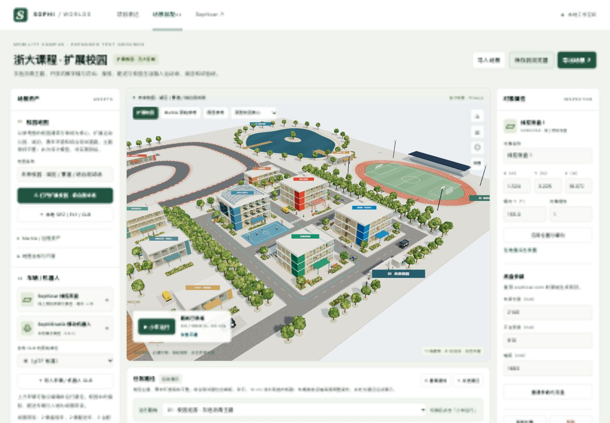
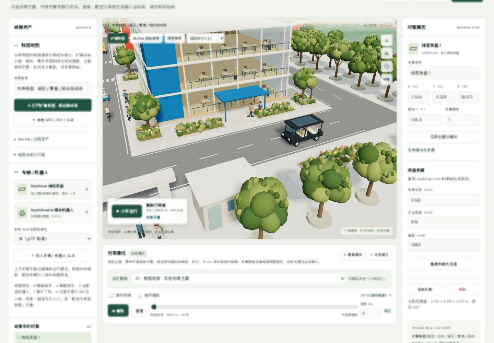
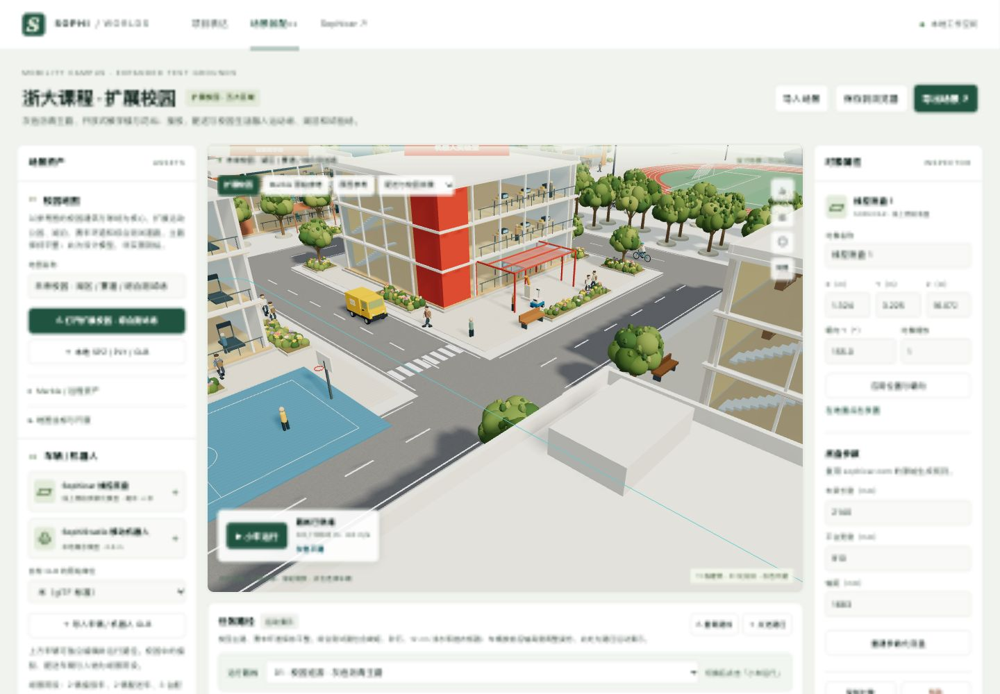

# 灰色道路与校园生活场景

2026-10-02，版本 `campus-street-life-20261002-v5`，入口 `worldlabstestv2.html`。

依据用户最近提供的校园图更新实际三维场景。主路和接入道路使用中性灰色沥青、白色车道线和斑马线；赛车道路为深灰色。综合测试道路继续保留崎岖、砂石、浅水和搓衣板四种表面。

## 建筑与花坛

- 新增创意教学楼、学生交流中心、智能交通工坊，带玻璃立面、家具、楼梯、雨棚及室内人物。连同原有图书馆、实验室、研究楼、运动中心、咖啡馆、创新工坊、测试站和维修区，共 11 栋主要建筑，不含入口门房。
- 新增 28 处花坛，共 51 处；补入黄、白、橙、紫、粉色花簇。全场 171 株乔木。
- 主路几何与原有三条车辆路线不变。新增花坛和建筑避开主路、赛车路缘及测试车道。

## 车辆与人物

以参考图的外形制作可旋转查看的三维陈设：2 辆深色开放式接驳车（含乘客）、2 辆黄色配送车、3 台蓝白配送机器人、1 辆橙黑卡丁车、4 位骑行者。全场另有 68 位室内外人物，包括乘客与驾驶员。

新增车辆、骑行者和人物是固定陈设，采用实例化绘制；当前不提供独立选择、驾驶、避障或行为仿真。原有 Sophicar 与移动机器人仍是独立可编辑对象，Sophicar 可通过“小车运行”完成校园、赛车或综合测试路径。

相机下拉增加“接驳车与入口”“配送与校园街景”“新增教学与服务区”，可直接查看细节；“原图校园核心”和“全园总览”仍然可用。

## 代码与归档

- `js/campus-life.js`：参考图车辆、乘客、骑行者、行人的几何及位置；按几何和材质批量实例化。
- `js/campus-reference.js`：建筑、庭院、花坛、室内人物。
- `js/campus-foliage.js`：树木、灌木与花簇。
- `js/test-road.js`、`js/campus-expansion.js`：灰色道路材质和场景装配。
- `data/campus-default.json`：默认场景版本及 13 个相机视角。
- `assets/campus-user-reference.png`：更新为本次用户附图。

原文件备份在 `runs/before-street-life-v5-20261002/`。浏览器升级前数据备份键为 `sophi-worlds-composition-v2-before-street-life`；保留已有车辆、参数和路线，仅更新场景版本、镜头与默认观察位置。

这仍是参考图驱动的校园设计模型，不是浙大实景测绘，也没有修改原始 Marble 世界。本次没有调用新的 World Labs 生成 API。

## 画面记录

