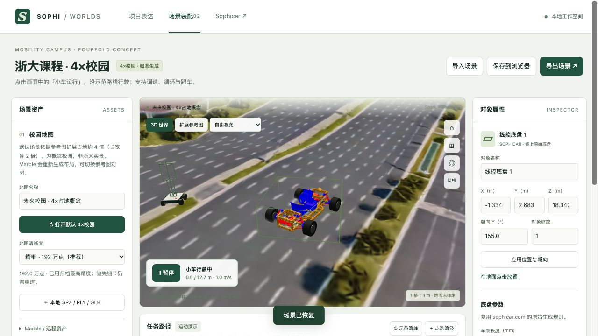

> 最新：默认路线已改用独立平路，远端新增石子路与浅水坑，见 [平路测试场](flat-road.md)。下文记录此前的原始地形贴地方案与点云清晰度说明。

# 建筑清晰度与小车运行

更新：2026-10-02。入口：[场景装配](../worldlabstestv2.html)。

## 为什么模糊

这次用一张 1536×1024 的校园鸟瞰概念图生成整片 360° 世界，建筑立面、背面与远处道路在原图中提供的细节有限。普通图片输入会先生成全景，再生成世界；因此生成结果包含推断，不能保证与参考图逐栋一致。近看时的拉伸、缺面与绿地穿插，主要是当前资产质量问题。依据：[World Labs 输入说明](https://docs.worldlabs.ai/api/world-generation-examples)。

此前默认用了 500k SPZ。本次默认升级为已经下载的 full_res：1,920,000 splats，约 31 MB，显示像素比上限从 1.75 提至 2；Spark 明确关闭景深和额外预模糊，使用该档完整点集。可在左侧清晰度下拉切回 500k 或 100k。Spark 参数依据：[渲染器文档](https://sparkjs.dev/docs/spark-renderer/)。这些调整改善显示条件，无法创造资产中缺失的立面或拓扑；本轮没有再次调用生成 API、导出收费 HQ mesh 或消耗额度。

## 解决路径

1. **近景展示**：按教学楼前道路、路口、测试场等局部区域分别建立世界；每个区块采用同一区域相互一致的多视角照片、360° 全景或连续视频，并保留原始视点。单纯把整校图放大像素，无法增加真实空间证据。World API 支持同场景多图及已知方位输入，详见上面的官方输入说明；效果仍需逐块检查。
2. **清晰课程原型**：主要建筑、路面、路缘和车道线用可编辑的 GLB 网格构建，保证形状与尺寸；Marble / Spark 用于外围植被与空间氛围。这个方向比反复锐化当前 splats 更能保证近看清楚、道路可控。
3. **真实校区与工程仿真**：导入已有三维校园地图并核验尺度，补结构化路网、碰撞体、交通规则，再接车辆运动学或物理引擎。生成出的 collider 可作草稿，不是测绘或安全验证依据。[官方交互示例](https://docs.worldlabs.ai/api/interactive-world-examples)也将 splats、网格、控制与物理作为不同组件组合。

建议下一步从一条 20–40 米校园道路及相邻建筑开始完成清晰网格版本，再按区块扩展；当前四倍校园保留作总体方案表达。

## 如何让小车运行

1. 刷新场景装配页。默认有一条约 12.7 米的道路示范路线；旧的默认校园配置会备份并升级，用户已经自定义的非空路线保留。
2. 点击画面左下角的 **小车运行**，或任务路径区的 **播放**。默认 2 m/s，约 6 秒走完；可随时暂停。
3. **跟车视角**使镜头随车移动；直接拖动三维视角会退出跟车，重新勾选即可恢复。
4. **循环播放**在到达终点后回到起点重复演示，它不是一条闭合道路环线。速度范围 0.1–10 m/s；**重置**回到路线起点。
5. 拖动进度条可查看路线中的任意位置。**示范路线**可恢复内置路线，会备份此前场景；**清空 → 点选路径**可给当前车辆设置新路线。
6. 自定义点选落在加载的地面网格上，路段约每 0.75 米采样地形高度，再按路段坡度调整车身俯仰。没有 collider 的普通场景仍用 Y=0 平面，并在坐标区域标注。超出网格的路线会提示错误并禁用播放，不会假装贴地成功。
7. 保存或导出 JSON 会记录车辆参数、路线、速度、循环设置与进度；刷新会恢复位置并保持暂停。

## 当前运行边界

这是 **按指定路线、按地形高度的运动演示**。尚未模拟转向机构、轮胎转动、四轮悬架接触、车辆动力学、避障、行人或交通规则。自定义路线不会自动避开建筑或树木。地面网格存在生成误差时，视觉上仍可能悬浮、穿插或出现不合理坡度；不能把播放成功视为车辆能够在真实道路安全通行。

地图和车辆处于同一 Three.js 场景，车辆不是烘焙到背景里的图片。后续可继续替换道路网格和车辆控制器，无需重新生成车辆。

## 本次改动

- `js/workbench-v2.js`：最高精度默认、旧默认升级、播放 HUD、跟车、循环、进度保存与贴地路线接入。
- `js/terrain-surface.js`：独立地面网格加载、坐标转换、射线查询与一次性路线采样；没有在每帧扫描全部三角形。
- `js/route-math.mjs`：按三维距离插值、方向与坡度、循环和终点处理。
- `tests/route-math.test.mjs`：坡面距离、退化路点、端点、转弯、循环和停止的回归检查。
- `data/campus-default.json`：精细 SPZ、道路示范及地面来源。

启动仍为 `python3 tools/worldlabs_server.py --no-api`；默认地图与运行演示均不需要 API Key。

## 实际运行预览

已验证播放、暂停、调速、循环、跟车、进度保存恢复，以及切换清晰度后位置保持。完整记录见 [验证记录](verification.md)。
