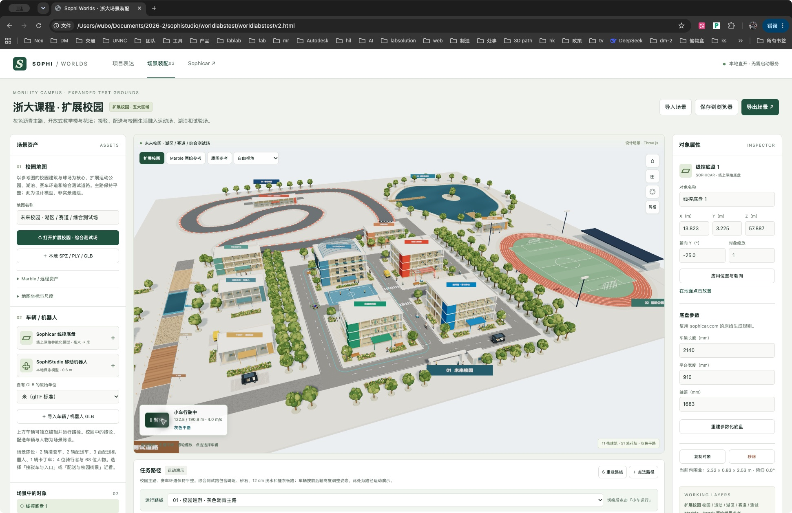

# 双击 HTML 直接运行

2026-10-03 已实现：在访达中双击 `worldlabstestv2.html`，即可在浏览器加载三维校园。无需先启动 Python、终端或本地服务器。点击「小车运行」即可巡游，也可切换赛车、综合测试道路与 Marble 原始参考。

请保留完整的 `worldlabstest` 文件夹。HTML 是入口，`js/launch-workbench.js` 和 `assets/offline/` 是直开所需资源；单独复制 HTML 不会带走模型。当前浏览器需支持 WebGL2。

已在外部 Chrome 的真实 `file://` 页面验证校园、车辆运行、192 万点 Marble 参考。当时本机 8766 端口没有服务运行。此前 HTTP 方式已在 Edge 验证；本轮 Edge 原生控制连接超时，因此未完成 Edge 的 file 模式实测。

## 两种入口

- 双击 HTML：默认校园、Sophicar 模型和 Marble 归档均读本地资源，不调用 World Labs API。自己的 SPZ / PLY / GLB 仍可通过文件选择器导入。
- HTTP 地址：保留原有模块加载和本机服务查询方式。可使用 `预览-Edge.command`，或按 README 启动服务。

不同浏览器以及 file / HTTP 入口各自保存编辑状态。长期归档请使用「导出场景」。JSON 不嵌入另外导入的模型文件，重新打开后需再次选择它们。

## 更新直开资源包

前端源码在 `js/`，直开构建在 `assets/offline/`。修改前端代码、默认场景或模型后，使用 Node.js 和 esbuild 重新构建：

```sh
node tools/build_offline.mjs
```

如果 esbuild 不在 PATH，可设置 `ESBUILD` 为其可执行文件绝对路径。构建依赖已归档的 Three 0.180.0 和 Spark 2.3.0；构建信息保存在 `assets/offline/build-info.json`。不需要 API Key，不会触发世界生成。

19 个模型与地图通过按需脚本加载，生成 Blob 供模型加载器读取。Spark 在 file 模式接收二进制字节，避免后台线程不能读取 file 页面的 Blob URL。整个方案没有更改浏览器安全设置或安装开机任务。


