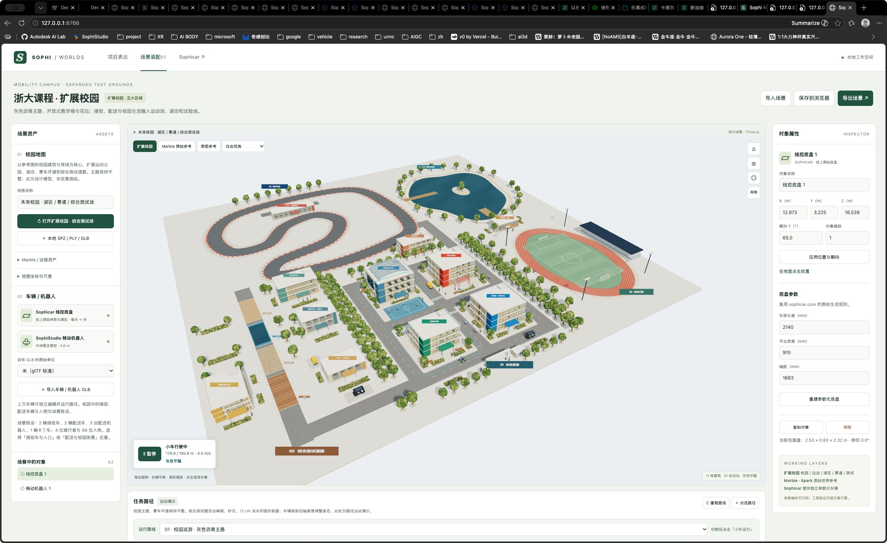

# 外部 Edge 预览

更新：v2 现在也支持双击 HTML 直接打开，见[直开说明](direct-open.md)。以下保留通过本机 HTTP 服务打开 Edge 的方式；不再是日常预览的前置步骤。

2026-10-03：本次“无法访问此页面 / ERR_CONNECTION_REFUSED”的原因是本机 8766 端口没有运行预览服务。恢复服务后，已在外部 Microsoft Edge 中确认三维校园正常显示，并观察到小车巡游进度从 19.9 m 增长至 176.9 m。

## 打开方式

双击项目目录中的 `预览-Edge.command`。它会检查现有服务，必要时启动后台预览，再使用 Microsoft Edge 打开：

http://127.0.0.1:8766/worldlabstestv2.html

启动窗口关闭后，本次启动的后台服务继续运行。电脑重启后需要再次双击。它仅监听本机地址，不会开放局域网访问，也不需要 World Labs API Key。

已有服务正常时会复用，不会重复启动；若端口返回其他页面，会提示错误，不会关闭其他进程。新服务日志保存在 `runs/preview-server.log`。

也可在终端进入项目目录，运行：

```sh
python3 tools/start_preview.py
```

仅启动或检查服务、不打开浏览器：

```sh
python3 tools/start_preview.py --no-browser
```

使用本页的服务方案时，通过上述 HTTP 地址访问。直接双击 HTML 也已支持。不同浏览器以及 file / HTTP 两种入口分别保存场景状态；传递自定义编辑时，可使用页面上的“导出场景 / 导入场景”。

验证方式：本机 HTTP 返回 200；外部 Edge 原生窗口检查了页面标题、真实三维画面与运行进度。Edge 没有连接 DOM 调试扩展，因此本次没有读取其开发者控制台日志。


